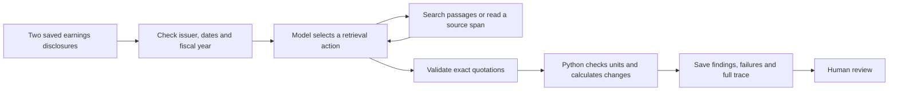

# EventLens

**An earnings investigation agent. It compares revenue guidance across company disclosures and links findings to saved source text.**

EventLens checks that the disclosures forecast the same fiscal year. It retrieves guidance and explanation passages, validates quotations, and uses Python to calculate changes. It records missing evidence and apparent conflicts for human review.

The current scope is annual total-revenue guidance. Human review of the labels is pending. The saved results measure output coverage, execution failures, and responses to synthetic controls. They do not establish accuracy or an advantage over the baselines.

## Example: a guidance revision

The [saved Adobe example](reports/earnings-v2-analysis-2026-10-13/adobe_example.md) compares these FY2025 targets:

| Disclosure | Quoted revenue guidance |
| --- | --- |
| [Q2 source](data/snapshots/ADBE-2025-Q2.txt) | “Total revenue  \| $23.50 billion to $23.60 billion” |
| [Q3 source](data/snapshots/ADBE-2025-Q3.txt) | “Total revenue  \| $23.65 billion to $23.70 billion” |

Python calculates a **USD 125 million increase in the midpoint**. The [source run](reports/earnings-v2-2026-10-13/runs/ADBE-FY2025-Q2-Q3_C.json) saves the retrieval actions, source quotations, validation results, and calculation. This is a development example. It does not measure accuracy on unseen cases. Human review of the explanation remains pending.

## How it works



The model can read only the selected disclosure pair. A conflict output requires two distinct source quotations. For the retrieval agent, each quotation must also appear in a returned passage. Exact quotation checks do not prove that an explanation is correct.

## Saved comparisons

The [corpus inventory](reports/earnings-m1-m3-2026-10-13/corpus_review.json) contains **36 pairs from 12 issuers**, with 12 development pairs and 24 held-out pairs. The issuer split was fixed before method D was developed. Prior exposure to the original pilot is documented in the [corpus protocol](docs/earnings_m1_m3.md).

| Method | Operation |
| --- | --- |
| A: rules | Extract guidance with fixed rules. |
| B: single-pass model | Give the model both saved disclosures in one request. |
| C: retrieval agent | Let the same model select passages within a fixed call budget. |
| D: document diff | Align sentences and table rows with `difflib`, then extract changed guidance. |

All methods use decimal arithmetic. In v2, all methods used the same evidence validator. The later B/C versions share a candidate parser with explicit table-column checks. A/D retain their earlier extraction rules. C can make more requests than B, so the comparison does not use equal compute budgets.

The [v8 analysis](reports/earnings-v8-analysis-2026-10-15/analysis.md) gives these results for the same 24 originally held-out real pairs. These inputs are now exposed regression cases. This is not a new blind test.

| Method | Pairs | Numerical outputs | No numerical output | Failed attempts | Median seconds |
| --- | ---: | ---: | ---: | ---: | ---: |
| A | 24 | 2 | 22 | 0 | 0.002 |
| B | 24 | 15 | 9 | 3 | 3.142 |
| C | 24 | 15 | 9 | 0 | 6.524 |
| D | 24 | 14 | 10 | 0 | 0.007 |

These are coverage and execution counts, not correctness rates. “No numerical output” includes failed attempts. B includes one request blocked to prevent a repeat of an earlier request with uncertain billing. The [evidence checkpoint](reports/earnings-evidence-v10-2026-10-15/evidence.md) gives costs, latency and review requirements.

The [original v2 analysis](reports/earnings-v2-analysis-2026-10-13/analysis.md) retains all earlier results. B and C each produced four numerical outputs on these pairs in v2. Different parser assistance and repeated exposure prevent a claim that the agent alone caused the later change.

The [benchmark protocol](docs/earnings_benchmark_v2.md) defines stale-disclosure, missing-numerical-evidence, and contradictory-commentary controls. The control named `missing_table` removes all numeric tokens from the current disclosure. It is broader than deleting one table. Contradictory statements are synthetic and use a known template.

The [v6 reference test](reports/earnings-v6-analysis-2026-10-15/analysis.md) completes four synthetic conflict cases for each of B and C, with two checked citations per flag. The [v7](docs/earnings_expansion_v7.md) and [v8](docs/earnings_expansion_v8.md) tests each save 288 four-method outcomes, including table-row deletion. All saved requests and results replay offline.

The [v9 stress test](docs/earnings_stress_v9.md) uses the original stale, missing-number and conflict inputs. The [BOX report](reports/earnings-examples-2026-10-15/box-arithmetic.md) shows arithmetic calculated from metric records. The [Synopsys report](reports/earnings-examples-2026-10-15/synopsys-synthetic-conflict.md) shows annual table evidence and two synthetic opposing quotations. Model prose still needs human review. The [natural withdrawal check](reports/earnings-v10-analysis-2026-10-15/analysis.md) distinguishes suspended annual guidance from missing numbers.

## Quick start: reproduce the evidence

### Prerequisites

- Python 3.11 or later
- A local copy of this repository
- No API key is needed for replay.

### Procedure

1. Create a Python environment:

   ```sh
   python3 -m venv .venv
   . .venv/bin/activate
   python -m pip install -c deploy/requirements.lock '.[service,test]'
   ```

2. Check the saved corpus:

   ```sh
   python scripts/prepare_earnings_corpus.py --check
   ```

3. Replay the corpus and table-row tests:

   ```sh
   python scripts/analyze_earnings_expansion_v8.py --check
   ```

4. Reproduce the stress and cost reports:

   ```sh
   python scripts/analyze_earnings_stress_v9.py --check
   python scripts/earnings_evidence_index_v10.py --check
   ```

5. Run the local checks:

   ```sh
   python -m unittest discover -s tests -v
   python scripts/service_smoke.py
   ```

Replay checks source and code hashes, each saved model request, evidence, and calculations. It uses recorded responses and makes no paid calls. New live experiments require a cost estimate and an explicit budget record; see the [live-run procedure](docs/earnings_benchmark_v2.md#budget-and-resumable-runs).

## Review the labels

Follow the [review procedure](docs/earnings_benchmark_v2.md#review-the-real-disclosures) to build the local review page. It displays the two disclosures side by side and records exact quotations, ranges, direction, explanations, reviewer identity, and review time.

The [pending review file](reports/earnings-v8-review-2026-10-15/labels.pending.json) adds machine suggestions. Back up an existing review before you restore this file. Draft labels do not enter accuracy scores. Exported reviews are checked against source hashes. Model-selected explanations need their own semantic review.

## Macro-event extension

EventLens also reads official calendars and dated sources to create a cited macro-event risk brief. The [saved live brief](reports/deepseek-live-2026-10-08/brief.md) includes a [calendar CSV](reports/deepseek-live-2026-10-08/calendar.csv). It reports missing evidence and does not produce trading signals.

This extension has an authenticated FastAPI service, a separate worker, SQLite storage, and Docker Compose deployment. Use the [reference](docs/reference.md) and [deployment guide](docs/deployment.md) for setup and API commands.

Replay the saved macro run without a paid call:

```sh
python scripts/verify_live_run.py reports/deepseek-live-2026-10-08 --allow-earnings-changes
```

## Documentation

| Document | Contents |
| --- | --- |
| [Corpus and diff baseline](docs/earnings_m1_m3.md) | Source provenance, issuer split, natural hard cases, and method D |
| [Investigation protocol](docs/earnings_benchmark_v2.md) | Model budgets, stress controls, review, and replay |
| [Original earnings pilot](docs/earnings_experiment.md) | Earlier experiment and results |
| [Architecture](docs/architecture.md) | Macro action protocol and data records |
| [Source formats](docs/global-workflow.md) | Calendar and research-source imports |

Owner and maintainer: **Xiangyi (Nick) Zhu**.
