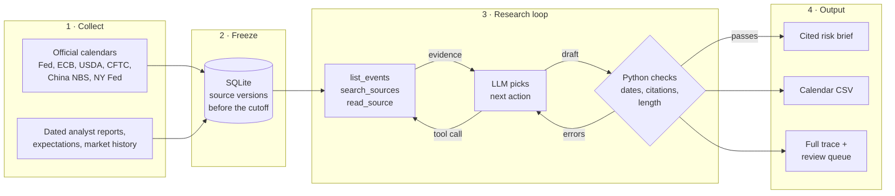
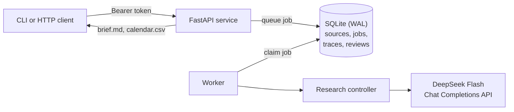

# EventLens

**A research agent that reads official calendars and dated sources, then writes a cited risk brief about the macro events in the next month.**

You give EventLens a date window and a set of markets. It finds the events that can move those markets: central-bank meetings, inflation and jobs releases, commodity reports, and policy risks. Then it writes a short brief for an analyst. Each claim in the brief links to an exact passage in a source document. Python checks every citation before the brief is saved.

EventLens warns analysts about volatility, liquidity, policy, and credit risk. It does not give trade signals or price targets.

## Example output

This excerpt comes from a [live run on 8 October 2026](reports/deepseek-live-2026-10-08/brief.md). The run took 33 seconds and cost about USD 0.008.

| Date / status | Event | Markets / assets | Priority |
| --- | --- | --- | --- |
| 2026-10-14 / confirmed [2] [3] | US Consumer Price Index | US, GLOBAL / equities, bonds, fx, energy, metals | high |
| 2026-10-27 to 10-28 / confirmed [5] | FOMC policy meeting | US / equities, bonds, fx, energy, metals | high |
| 2026-10-28 to 10-29 / confirmed [6] [7] | ECB monetary policy meeting | EU, GLOBAL / equities, bonds, fx | high |
| 2026-10-31 / tentative [8] [9] | China manufacturing PMI | CN, HK, GLOBAL / equities, bonds, fx, metals, energy | high |

Each `[n]` is a citation to a stored source span. When evidence is missing, the brief says so. It does not guess. The run also exports a [calendar CSV](reports/deepseek-live-2026-10-08/calendar.csv) for Excel.

## How it works



1. **Collect.** Collectors read official calendars and policy documents. You can also import dated analyst reports and market history.
2. **Freeze.** Each job fixes an information cutoff and the source versions that it can use. Sources that arrive later cannot change the job.
3. **Research.** The model chooses one action at a time. It can list events, search sources, or read an exact passage. Python runs each tool and enforces a budget of 20 model calls and 18 tool calls.
4. **Check and save.** Python rejects drafts with wrong dates, bad citation spans, or too many words, and it sends the errors back to the model. A draft that passes becomes the brief. An analyst then reviews the claims.

## Architecture



| Part | Technology |
| --- | --- |
| Research engine | Python 3.11+ standard library |
| Agent | One LLM with a JSON action protocol (DeepSeek Flash by default) |
| Service | FastAPI, Pydantic, Uvicorn, and a separate worker process |
| Storage | SQLite with write-ahead logging, shared through a Docker volume |
| Deployment | Docker Compose; the API binds to `127.0.0.1:8000` |
| Tests | `unittest`, HTTP acceptance checks, and GitHub Actions |

The event catalog has 41 entries across China, Hong Kong, Taiwan, Southeast Asia, Europe, the US, Japan, and global markets.

## Quick start

### Prerequisites

- Docker with Compose
- Python 3.11 or later
- A [DeepSeek API key](https://platform.deepseek.com/api_keys). Without a key, you can use `--method rules`, which collects calendar evidence but does not do risk analysis.

### Procedure

1. Clone the repository and create the settings file:

   ```sh
   git clone https://github.com/NickZhuxy/EventLens.git
   cd EventLens
   cp .env.example .env
   ```

2. In `.env`, set `EVENTLENS_SERVICE_TOKEN` to a random value and `EVENTLENS_API_KEY` to your DeepSeek key. To make a token, run `python3 -c 'import secrets; print(secrets.token_urlsafe(32))'`.

3. Start the API and the worker:

   ```sh
   docker compose up --build -d
   curl --fail http://127.0.0.1:8000/health/ready
   ```

4. Install the client and request a brief for the next 31 days:

   ```sh
   python3 -m venv .venv && . .venv/bin/activate
   python -m pip install .
   set -a && . ./.env && set +a
   eventlens-service request --refresh --days 31 --markets GLOBAL --out work/current-brief
   ```

5. Open `work/current-brief/brief.md` and `work/current-brief/calendar.csv`.

## Verify

```sh
python -m pip install -c deploy/requirements.lock '.[service,test]'
python -m unittest discover -s tests -v
python scripts/verify_live_run.py reports/deepseek-live-2026-10-08
```

The last command replays the saved live run without a key or a paid call. It checks the source and code hashes, each model request, and the final draft.

## Documentation

| Document | Contents |
| --- | --- |
| [Reference](docs/reference.md) | Agent tools, API routes, source coverage, full deployment steps, and verification records |
| [Architecture](docs/architecture.md) | Action protocol and data records |
| [Deployment](docs/deployment.md) | Configuration, HTTPS, backups, logs, and recovery |
| [Source formats](docs/global-workflow.md) | How to import calendars and research sources |

Owner and maintainer: **Xiangyi (Nick) Zhu**.
