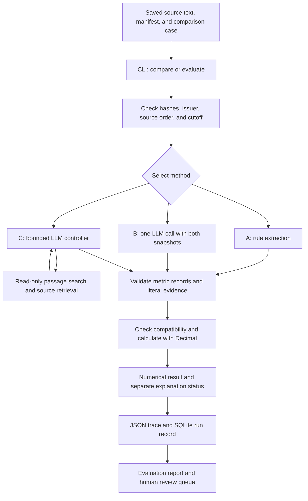

# Earnings-guidance experiment

Latest checkpoint: [v6–v10 evidence](../reports/earnings-evidence-v10-2026-10-15/evidence.md) adds full-corpus regression, table-row deletion, complete synthetic stress checks, and explicit annual withdrawal handling. Every saved request/result replays. All 36 natural labels and 33 sampled semantic judgments remain pending. The sections below retain the original pilot and historical v2 results.

The [v2 investigation checkpoint](earnings_benchmark_v2.md) now has 440 saved four-method runs and 342 recorded model requests, all replayed offline. Its conservative token-cost estimate is USD 1.3671111 under Nick's approved USD 8 cap. The [execution analysis](../reports/earnings-v2-analysis-2026-10-13/analysis.md) reports coverage, failures and synthetic stress outcomes; human labels remain pending.

October 13, 2026 update: the [M1/M3 checkpoint](earnings_m1_m3.md) expands the corpus to 36 pairs across 12 issuers and adds method D with saved offline replay. The three-pair results below document the original pilot. The expanded live B/C results are linked above; human-reviewed accuracy remains pending.

Earnings investigation is the primary workflow. The macro-event workflow remains a secondary extension. Start with the [main README](../README.md) for the current project. The later sections below retain the original earnings pilot and its reproduction commands.

Owner and maintainer: **Xiangyi (Nick) Zhu**.

EventLens compares corporate revenue guidance for the same fiscal year. Guidance is a company's forecast. A reported result and a forecast are different records. Two quarterly releases can forecast different periods. EventLens must check the period before it calculates a change.

EventLens is a personal research implementation. It uses public sources and includes no employer code or documents. This project is not an approved course submission.

## Research question

Can a large language model (LLM), with passage retrieval, extract guidance changes with better evidence than simpler methods?

At the original October 7 pilot checkpoint, the offline workflow operated and the LLM comparison was unmeasured. The later live benchmark is linked above. No claim of improved model performance is supported without the required human review.

## Architecture

The command-line interface (CLI) selects a case, method, and information cutoff. A case identifies one issuer, two source snapshots, and one forecast horizon. All methods use the same eligible pair and the same Python validation and comparison functions.



An invalid pair stops before extraction or model access. An invalid or absent extraction produces an abstention. Every completed run retains its result and trace.

### Repository structure

```text
EventLens/
├── src/eventlens/
│   ├── cli.py              # Commands, report files, and review records
│   ├── core.py             # Source and Metric records, Decimal, SQLite
│   ├── pipeline.py         # Shared disclosure-comparison workflow
│   ├── extraction.py       # Rule baseline and evidence checks
│   ├── llm.py              # Model adapter and bounded controller
│   ├── retrieval.py        # Validated read-only source tools
│   ├── challenges.py       # Synthetic source transformations
│   └── evaluation.py       # Scores, denominators, and report text
├── data/
│   ├── manifest.json       # Source metadata and content hashes
│   ├── cases.json          # Eligible pairs, questions, cutoffs, and splits
│   ├── snapshots/          # Saved normalized disclosure text
│   ├── captures/           # Original web-reader captures
│   └── labels.draft.json   # AI-drafted labels; human review pending
├── configs/
│   ├── protocol.json       # Research question and issuer split
│   ├── freeze.json         # Frozen rule hashes and recorded amendment
│   └── model.json          # Model identifier and execution budgets
├── fixtures/               # Synthetic cases and a mock controller trace
├── tests/                  # Arithmetic, evidence, tool, and evaluation tests
├── scripts/
│   └── verify_fresh.py     # Installation and reproduction check
├── reports/
│   ├── offline-v2/         # Current saved evaluation and raw runs
│   ├── offline-v1/         # Earlier results, retained for inspection
│   └── runs/               # Individual comparison and demo traces
├── docs/                   # Design, provenance, review, and ownership notes
└── work/                   # Local database and temporary files; not tracked
```

### Module responsibilities

| Module | Main interface | Responsibility |
| --- | --- | --- |
| [cli.py](../src/eventlens/cli.py) | `main`, `load_cases`, `persist_run` | Read commands and configuration; save outputs; append reviews |
| [core.py](../src/eventlens/core.py) | `Source`, `Metric`, `load_corpus`, `compare`, `Store` | Validate records; normalize units; calculate changes; store immutable records |
| [pipeline.py](../src/eventlens/pipeline.py) | `run_pair` | Apply common eligibility checks; call the selected method; combine results |
| [extraction.py](../src/eventlens/extraction.py) | `extract`, `validate_evidence`, `explanation_status` | Extract annual revenue ranges; check quotes; flag explicit opposing explanations |
| [llm.py](../src/eventlens/llm.py) | `LiveAdapter`, `MockAdapter`, `model_extract` | Send model requests; validate JSON actions; enforce budgets; save responses |
| [retrieval.py](../src/eventlens/retrieval.py) | `ReadTools.execute` | Search or read only the allowed pair within its cutoff |
| [challenges.py](../src/eventlens/challenges.py) | `make_challenges` | Create labeled synthetic changes to the development case |
| [evaluation.py](../src/eventlens/evaluation.py) | `score`, `report_text` | Compare outputs with labels; report errors, abstentions, and unmeasured fields |

### One comparison, step by step

1. `load_corpus` reads the manifest and local text. It checks timestamps and each content hash.
2. `load_cases` checks source IDs, issuer, forecast horizon, and the configured issuer split.
3. `run_pair` checks source order and the information cutoff. These checks occur before model access.
4. A, B, or C returns two metric records or explicit missing values. All methods use the same record schema.
5. `validate_evidence` checks literal passages and screens the metric, values, units, and horizon. Human semantic review remains separate.
6. `compare` checks issuer, metric, currency, accounting basis, horizon, calendar, and definition. It then normalizes units and calculates the change with `Decimal`.
7. The pipeline records the numerical conclusion and the explanation conclusion separately. A conflict can flag the overall result while the numerical calculation remains visible.
8. The CLI saves the JSON output and a SQLite run record. An evaluation also saves scores, prompts, input hashes, draft labels, and a review queue.

Results can be `supported`, `conflicting`, or `insufficient_evidence`. Here, `supported` means that the numerical evidence passed the implemented automated checks. A literal quotation alone does not prove semantic support.

### Records and persistence

| Record | Required information | Storage |
| --- | --- | --- |
| Source | Issuer, URL, publication and availability times, retrieval time, reporting period, forecast horizons, text hash | `data/manifest.json`, snapshot text, SQLite `sources` |
| Metric | Source ID, metric, currency, units, basis, horizon, definition, status, bounds, evidence and horizon passage | Each run's `extractions` field |
| Run | Input hashes, case, method, configuration, result, errors, trace, measured calls and latency | `reports/` JSON files and SQLite `runs` |
| Review | Observation ID, source hash, reviewer, decision, note and timestamp | `data/reviews.jsonl` and SQLite `reviews` |

The database is `work/eventlens.sqlite`. `ingest` inserts source records. Repeated ingestion of the same record adds no duplicate. A changed record with an existing source ID is rejected. Runs and reviews remain separate records.

Comparison commands read the saved manifest and text directly. They do not require an earlier database import. The database records ingestion, runs, and reviews; it is not a retrieval index.

### Retrieval controller

C starts with the question and allowed source metadata. The model returns a JSON action: request a tool or finish with metric records. Tool results become the next model input. The controller stops when the model finishes, an error occurs, or a budget is exhausted.

| Tool | Arguments | Behavior |
| --- | --- | --- |
| `search_passages` | `source_id`, `query` | Rank 1,400-character text windows by query-term matches; return up to three windows with offsets |
| `get_source` | `source_id`, `start`, `end` | Return an exact source span of at most 6,000 characters |

Both tools validate their arguments and enforce the allowed source pair and cutoff. They do not accept network URLs, file paths, or write operations. C may cite only text returned by its tools. The model does not calculate the numerical revision.

Current limits come from [configs/model.json](../configs/model.json):

| Budget | B: single pass | C: retrieval controller |
| --- | ---: | ---: |
| Maximum model calls per case | 1 | 6 |
| Maximum tool calls per case | 0 | 5 |
| Maximum input characters per model call | 160,000 | 160,000 |
| Maximum output tokens per model call | 1,800 | 1,800 |
| Maximum output tokens across model calls | 1,800 | 10,800 |

The character cap is not a token estimate. Actual provider token usage is saved when available. B and C use the same configured model, pair, question, and cutoff. Their supplied context and call budgets differ. The comparison is not compute matched.

The Python package uses the standard library and SQLite. It has no runtime package dependencies. Live B/C requests use an optional Chat Completions-compatible HTTPS endpoint. The offline workflow does not require that endpoint.

## Install

Prerequisites: Python 3.11 or later and `pip`. Internet access is necessary for the first installation of the pinned build dependency. The saved-data experiment then runs offline. Python 3.14.6 was used for the saved validation.

1. Clone the repository. Repository access is required.

   ```sh
   git clone https://github.com/NickZhuxy/EventLens.git
   ```

2. Open the project directory.

   ```sh
   cd EventLens
   ```

3. Create an environment.

   ```sh
   python3 -m venv .venv
   ```

4. Install the package.

   ```sh
   .venv/bin/python -m pip install .
   ```

Use a regular installation. This machine marks some files in hidden directories with a macOS hidden flag. That flag caused Python to ignore the path file from an editable installation. After a code change, run the installation command again.

## Run the offline experiment

Run these commands from the project directory:

```sh
.venv/bin/eventlens validate
.venv/bin/eventlens ingest
.venv/bin/eventlens ingest
.venv/bin/eventlens demo
.venv/bin/python -m pip install -c deploy/requirements.lock '.[service,test]'
.venv/bin/python -m unittest discover -s tests -v
.venv/bin/eventlens evaluate --out reports/my-offline-run
```

The second import adds zero sources. Each evaluation needs a new output directory. The program preserves earlier results.

## Real example

Adobe's FY2025 revenue range changed between its [June 12 release](https://www.sec.gov/Archives/edgar/data/796343/000079634325000064/adbeex991q225.htm) and its [September 11 release](https://www.sec.gov/Archives/edgar/data/796343/000079634325000102/adbeex991q325.htm).

| Source | Fiscal horizon | Revenue guidance, USD billion |
| --- | --- | --- |
| June 12, 2025 | FY2025 | 23.50 to 23.60 |
| September 11, 2025 | FY2025 | 23.65 to 23.70 |

Python calculates `(23.65 + 23.70) / 2 - (23.50 + 23.60) / 2 = 0.125` billion USD. The midpoint increased by **$125 million**. This is a change in guidance, not a change in actual revenue.

The saved records contain each revenue row and its fiscal-year heading. The demo also removes a revenue row and adds conflicting statements in separate synthetic cases. The program then abstains or flags the conflict.

## Methods and measured results

| Method | Implementation | Evaluation status |
| --- | --- | --- |
| A: deterministic rules | Annual revenue row and heading extraction; exact arithmetic | Run on the saved corpus |
| B: single-pass LLM | Complete saved pair in one model call | Live results unmeasured |
| C: retrieval-assisted LLM | Bounded controller; passage search and source retrieval | Scripted tests pass; live results unmeasured |

The corpus has **6 source snapshots, 3 issuers, and 3 eligible comparisons**. Adobe is the development issuer. Salesforce and Autodesk are the held-out issuers.

Against **AI-drafted labels**, A returned 4 correct records from 6 expected records. Combined precision was 4/4; recall was 4/6. Held-out recall was 2/4. It calculated two correct midpoint changes and abstained on Salesforce's table. These results are **provisional**. Nick has not reviewed the labels.

The fresh-environment check passed **37 tests** and reproduced the evidence and conclusions of all **12 saved cases**. See [the verification record](../reports/fresh_environment.json).

Nine synthetic controls passed their expected status checks, including six expected abstentions. These controls are not nine additional company events. Human evidence-support errors and live model token usage remain unmeasured.

Read [the saved report](../reports/offline-v2/report.md), [failure analysis](../reports/failure_cases.md), and [review instructions](../docs/label_review.md).

## Run B and C with an authorized model

Set `EVENTLENS_API_KEY` and `EVENTLENS_MODEL` in your shell. Do not put a key in a command argument or a tracked file. The program also accepts `OPENAI_API_KEY`. It does not load `.env` files.

```sh
.venv/bin/eventlens evaluate --live --out reports/my-live-run
```

The same model runs B and C. See [configs/model.json](../configs/model.json) for budgets. B receives the complete saved pair. C receives metadata, then the passages that its tools return. Both use the same pair and cutoff. The calls and context budgets differ. Each model request, response, tool result, and supplied context is saved. Provider token usage is saved when available. API requests can incur charges.

For a scripted engineering demonstration:

```sh
.venv/bin/eventlens mock-demo
```

This command uses no LLM. Its results must not be included in model performance claims.

## Limits and ownership

The snapshots contain normalized reader text. They are not original HTML bytes. One Autodesk appendix is incomplete. The main guidance table is present. See [source provenance](../docs/data_provenance.md).

The cutoff uses conservative publication dates. It does not prove that these exact bytes were available historically. A stricter retrieval-time check is available:

```sh
.venv/bin/eventlens compare --case ADBE-FY2025-Q2-Q3 --cutoff-mode snapshot
```

All three real pairs are upward revisions. This small sample does not establish general performance. The extraction rules support a narrow annual revenue layout. Operating-margin arithmetic has unit tests; operating-margin extraction is not part of this experiment. No return prediction, investment performance, or causal effect is claimed.

AI assistance produced the implementation and draft labels under Nick's direction. See [contributions](contributions.md), [design decisions](design_decisions.md), and the [current review procedure](earnings_benchmark_v2.md#review-the-real-disclosures). Private planning and interview notes are excluded from this repository.
