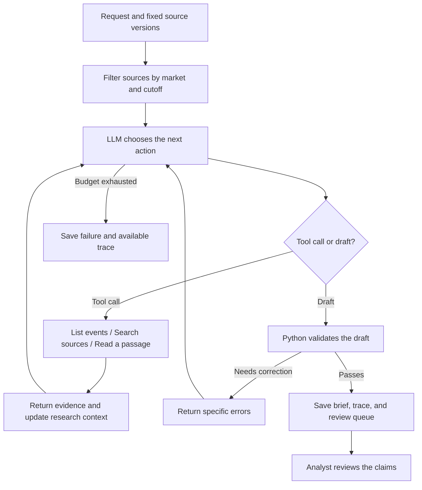
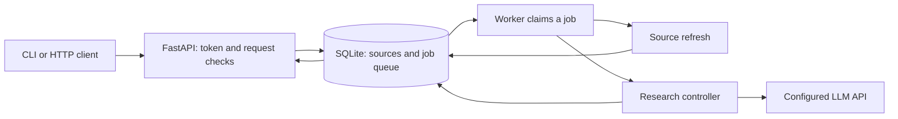

# EventLens reference

This page has the detailed reference material for EventLens. For an overview and quick start, read the [README](../README.md).

## Tech stack

| Part | Technology | Purpose |
| --- | --- | --- |
| Research engine | Python 3.11+ | Control tools, dates, citations, and execution budgets |
| Agent | A single large language model (LLM) with a JSON action protocol | Choose research tools, inspect evidence, and revise the draft |
| Model connection | DeepSeek Flash through its Chat Completions API | Run the research loop with low reasoning effort; retry temporary failures |
| HTTP service | FastAPI, Pydantic, and Uvicorn | Validate requests, require authentication, and expose job results |
| Data collection | Official RSS feeds and calendar parsers | Collect Fed documents and ECB, USDA, CFTC, China NBS, NY Fed, and BLS schedules |
| Retrieval | Word search and exact character offsets | Return source passages that the agent can cite |
| Persistence | SQLite with write-ahead logging (WAL) | Store source versions, jobs, run traces, and analyst decisions |
| Deployment | Docker Compose | Run the API and worker with a shared persistent volume |
| Verification | `unittest`, HTTP acceptance checks, and GitHub Actions | Test the research loop, service, failure handling, and container build |

The research engine uses Python's standard library. The service adds FastAPI and Uvicorn. Service dependencies are pinned in [`deploy/requirements.lock`](../deploy/requirements.lock).

## How the agent works

The model chooses its next research action. Python controls source access and checks the result.



1. **Fix the research scope.** The service records the request, configuration, and source versions in a job. Later source imports cannot change that job.
2. **Check the event universe.** Python combines source-backed dates with the event catalog. A typical monthly pattern does not establish an event date. The agent sees dated events and undated watchlist entries.
3. **Research important events.** The agent searches for relevant context, expectations, market history, and analyst reports. It can filter searches by event and source type. Tool results include text, dates, and character offsets.
4. **Prepare the brief.** The agent selects up to eight important events. It separates facts, historical impact, expectations, analyst views, and risk assessments. Unsupported claims remain gaps.
5. **Check and revise.** Python checks event coverage, dates, citation spans, and length. An invalid draft returns to the agent with errors to correct.
6. **Save the result.** The worker stores the brief and trace. Analysts can append review decisions through the API.

| Tool | Input | Result |
| --- | --- | --- |
| `list_events` | Empty object | Dated events and undated watchlist entries, with market and asset tags |
| `search_sources` | A query; optional event and source-type filters | Up to five matching passages from eligible sources |
| `read_source` | Source ID and character range | An exact source span, up to 6,000 characters |

The default budget is 20 model calls, 18 tool calls, and 450 narrative words. The model cannot change the cutoff or access arbitrary files and URLs. Source collection runs separately from the research loop.

The supplied configuration uses [DeepSeek Flash](https://api-docs.deepseek.com/quick_start/pricing/) (`deepseek-flash`). DeepSeek selects a tool or returns a draft as a JSON object. Python executes each allowed tool and returns the result to DeepSeek. Each model call has a limit of 6,000 output tokens. The saved trace contains the model response, token usage, provider settings, and retry counts.

## Service structure



The API returns a job ID before research starts. A separate worker claims each queued job in a database transaction. A heartbeat records worker health. If a worker disappears, its active job is marked as failed after its lease expires. The service does not automatically repeat that job's paid model calls.

Use an `Idempotency-Key` header to repeat a submission without creating another job. Reusing the key with a different request returns a conflict. The queue has a configurable capacity limit.

## Deploy and run

Prerequisites: Git, Docker with Compose, and Python 3.11 or later for the command-line client. Agent runs also need a [DeepSeek API key](https://platform.deepseek.com/api_keys) and available API credit.

1. Clone the repository.

   ```sh
   git clone https://github.com/NickZhuxy/EventLens.git
   cd EventLens
   ```

2. Create the local configuration.

   ```sh
   cp .env.example .env
   ```

3. Generate a service token.

   ```sh
   python3 -c 'import secrets; print(secrets.token_urlsafe(32))'
   ```

4. Edit `.env`. Set `EVENTLENS_SERVICE_TOKEN` to the generated token. Set `EVENTLENS_API_KEY` to your DeepSeek key. The file already contains these model settings:

   ```dotenv
   EVENTLENS_MODEL=deepseek-flash
   EVENTLENS_BASE_URL=https://api.deepseek.com
   EVENTLENS_REASONING_EFFORT=low
   ```

   Keep `.env` local. Git excludes this file. See [model configuration](deployment.md#configuration) to change the provider or reasoning effort.

5. Start the API and worker.

   ```sh
   docker compose up --build -d
   ```

6. Check service health.

   ```sh
   curl --fail http://127.0.0.1:8000/health/ready
   ```

7. Install the command-line client in a Python environment.

   ```sh
   python3 -m venv .venv
   . .venv/bin/activate
   python -m pip install .
   ```

8. Load the local configuration into the shell.

   ```sh
   set -a
   . ./.env
   set +a
   ```

9. Request a brief for the next 31 days.

   ```sh
   eventlens-service request --refresh --days 31 --markets GLOBAL --out work/current-brief
   ```

Open `work/current-brief/brief.md`. The directory also contains `calendar.csv`, `refresh.json`, `job.json`, `run.json`, and `review_queue.json`. Open `calendar.csv` in Excel to inspect all event candidates. Use a new output directory for each request.

The request command refreshes the official sources before it sets the information cutoff. It uses `snapshot` mode, which excludes documents captured after that cutoff. To check the full service without a model key, add `--method rules`; this method extracts calendar evidence. It does not perform risk analysis.

The Compose setup binds the API to `127.0.0.1:8000`. It runs both containers as a non-root user and keeps data in a named volume. See [deployment operations](deployment.md) for HTTPS access, backups, logs, and recovery.

After you change a key or model setting in `.env`, run `docker compose up -d` to create containers with the new environment. A container restart does not load these changes.

## API

All `/v1` routes and `/openapi.json` require `Authorization: Bearer <service-token>`. Health routes do not require a token.

| Route | Function |
| --- | --- |
| `GET /v1/catalog` | Read event families, markets, and provider names |
| `POST /v1/refresh` | Refresh all providers or a selected provider list |
| `POST /v1/calendar` | Import sourced event dates or tentative date windows |
| `POST /v1/sources` | Import source text and publication metadata |
| `GET /v1/sources` | List stored source versions |
| `GET /v1/sources/{id}` | Read source text and collection records |
| `POST /v1/briefs` | Queue an `agent`, `single`, or `rules` briefing |
| `GET /v1/jobs/{id}` | Read status, result, and execution trace |
| `GET /v1/jobs/{id}/brief` | Download the Markdown brief |
| `GET /v1/jobs/{id}/calendar.csv` | Download the full calendar and watchlist for Excel |
| `POST /v1/jobs/{id}/reviews` | Append an analyst decision |
| `GET /v1/jobs/{id}/reviews` | Read review history |
| `GET /v1/status` | Check sources, workers, queue counts, and model configuration |

See [request examples](deployment.md#api-examples) and the authenticated OpenAPI schema for field definitions.

## Verification

Install the service and test dependencies before running the checks:

```sh
python -m pip install -c deploy/requirements.lock '.[service,test]'
python -m unittest discover -s tests -v
python scripts/service_smoke.py
```

The HTTP check starts a real API process and worker. It imports sources, submits a job, checks repeated submissions, downloads the brief, and stores a review. Tests also cover citation repair, cutoff rules, concurrent job claims, interrupted workers, provider retries, and authentication. DeepSeek tests check request fields, credential selection, and saved job settings with simulated provider responses.

To test the running service with current sources and the configured model:

```sh
python scripts/service_smoke.py --url http://127.0.0.1:8000 --refresh --live
```

Saved acceptance records identify whether a run used a live model or deterministic rules. See the [HTTP acceptance record](../reports/service-http-acceptance.json) and [container acceptance record](../reports/service-container-acceptance.json).

The [first live DeepSeek run](../reports/deepseek-live-acceptance.json) completed on 8 October 2026. It used 11 public source versions and selected eight events from 45 candidates. The model made five calls and used three research tools. Validation rejected the first draft. The model revised it, and the second draft passed the citation and structure checks.

Read the [saved brief](../reports/deepseek-live-2026-10-08/brief.md) and [calendar CSV](../reports/deepseek-live-2026-10-08/calendar.csv). The run took 33 seconds. It remains `partial` because current market expectations and some other research sources were unavailable. This run checks the deployed workflow. It does not establish research quality across other cases.

The [estimated API cost](../reports/deepseek-live-2026-10-08/cost_estimate.json) was USD 0.008. This estimate uses the recorded token counts and published rates for that time. It is not a provider invoice.

To reproduce the controller steps without a key or paid model call:

```sh
python scripts/verify_live_run.py reports/deepseek-live-2026-10-08
```

This check uses saved model responses. It verifies the source and code hashes, each model request, tool results through the next request, and the final draft. The saved [run record](../reports/deepseek-live-2026-10-08/run.json) contains the live model responses and token counts.

## Project structure

```text
src/eventlens/
  service/
    api.py          Authenticated API and request validation
    store.py        Source versions, job transactions, and reviews
    ingestion.py    Fed document collection and source imports
    providers.py    Official calendar collectors and isolated errors
    worker.py       Job execution, heartbeats, and shutdown
    client.py       Brief requests and result downloads
    settings.py     Server configuration and budgets
  macro/
    agent.py        Model loop and validation feedback
    tools.py        Calendar, search, and source reads
    records.py      Source identity, dates, and calendar extraction
    catalog.py      41 event entries, market scope, and asset tags
    schedules.py    Confirmed dates, tentative dates, and date windows
    validation.py   Brief and citation checks
    report.py       Short briefs, calendar CSV, and review queues
    evaluation.py   Method comparison and measurements
  llm.py            Model transport, timeout, and bounded retries
deploy/             Pinned service dependencies
compose.yaml        API, worker, and persistent volume
Dockerfile          Application image
tests/              Research and service tests
```

Read [the architecture guide](architecture.md) for the action protocol and data records. Saved historical cases and the `single` and `rules` baselines support reproducible comparison with the agent. The earlier [earnings experiment](earnings_experiment.md) is also retained.

## Source coverage

| Provider | Automatic collection |
| --- | --- |
| Federal Reserve | FOMC statements, minutes, and stated next-meeting dates |
| European Central Bank (ECB) | Monetary policy meeting dates |
| US Department of Agriculture (USDA) | WASDE crop-report release dates |
| Commodity Futures Trading Commission (CFTC) | Commitments of Traders release dates, including holiday changes |
| China National Bureau of Statistics (NBS) | Manufacturing PMI dates, including delayed releases |
| New York Fed economic calendar | US employment, CPI, PPI, ISM manufacturing, and consumer confidence dates |
| US Bureau of Labor Statistics (BLS) | Employment, CPI, and PPI calendar parser; collection depends on site access |

The catalog defines research coverage. It does not claim that all 41 entries have automatic feeds. Other event dates use the sourced calendar import. Dated analyst reports, market expectations, and historical market reactions use the source import. See [source and calendar formats](global-workflow.md).

Each refresh reports provider failures and keeps successful imports. During the latest acceptance check, BLS returned HTTP 403. The New York Fed calendar supplies the US employment and inflation dates through a separate collector. Calendar pages with no publication timestamp use the first capture time as the information boundary.

[The global acceptance record](../reports/global-service-acceptance.json) records live collection and service checks. The [DeepSeek acceptance record](../reports/deepseek-live-acceptance.json) also records a live model run. A valid citation confirms a source span; an analyst must still assess its meaning.
